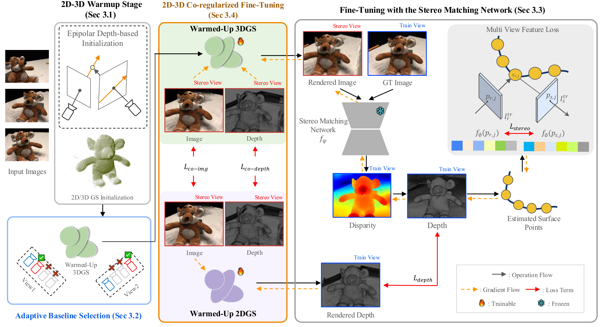

<h2 align="center">
  Sparse-GS2Mesh: 3D Gaussian Splatting Guided by Novel Stereo Views and 2DGS for Sparse View Surface Reconstruction
</h2>
<h4 align="center">NeurIPS 2026 Workshop (PhysWorldAI)</h4>
<div align="center">
  Younghyun Noh&emsp;
  Minje Kim&emsp;
  Tae-Kyun Kim
</div>
<p align="center">
  <a href="https://arxiv.org/abs/2610.04203" target='_blank'></a>
</p>

## Overview

<div align="center"></div>

Sparse-GS2Mesh reconstructs surfaces from three input views. A 3DGS and a 2DGS initialized with epipolar depth
priors are warmed up, then

1. **adaptive baseline selection** picks, for every input view, the stereo baseline whose stereo depth is most
   consistent with the other views (multi-view feature score),
2. the 3DGS is **fine-tuned through a frozen stereo matching network** (DEFOM-Stereo) so that its novel stereo views
   give better stereo depth, and
3. **2D/3D co-regularization** keeps the 3DGS and the 2DGS consistent in images and depths.

The mesh is fused (TSDF) from the stereo depths of the input views; occluded regions are completed with the epipolar
depth prior.

## Installation

```bash
git clone https://github.com/yhnoh8623/s-gs2mesh.git
cd s-gs2mesh
bash scripts/setup_env.sh        # conda env "sgs2mesh", CUDA extensions, DEFOM-Stereo + weights
conda activate sgs2mesh
```

Tested on Ubuntu 24.04, CUDA 12.8, PyTorch 2.7.1 and an A100 80GB GPU.

## Dataset

### DTU dataset

Sparse-view DTU (input views 22, 25, 28 for little overlap), one folder per scan:

```
data/DTU_little_GT/
├── scan24/
│   ├── images/          0000.png 0001.png 0002.png
│   ├── sparse/0/        COLMAP cameras of the input views
│   ├── mask/            object masks of the input views (022.png 025.png 028.png)
│   ├── flow/            optical flows between the input views (<image>_<i>_<j>.flo)
│   └── cameras.npz      DTU cameras (world_mat_*, scale_mat_*)
├── ...
└── SampleSet/MVS_Data/  official DTU evaluation data (Points/stl, ObsMask)
```

## Running

Train, extract the mesh and evaluate every scan:

```bash
python run_dtu.py --gpu 0 --output output/dtu_little
# subset of scans / large-overlap baseline candidates
python run_dtu.py --gpu 0 --scans 24 37 --setting large --data_dir data/DTU_large_GT
```

Or step by step:

```bash
# warm-up (3DGS, 2DGS) -> adaptive baseline selection -> fine-tuning
python train.py -s data/DTU_little_GT/scan24 -m output/scan24 -r 1
# stereo depths + TSDF -> output/scan24/mesh/mesh_cleaned.ply
python extract_mesh.py -s data/DTU_little_GT/scan24 -m output/scan24 -r 1
# cull with the input-view masks and compute the Chamfer distance
python evaluation/dtu/cull_mesh.py --scan_dir data/DTU_little_GT/scan24 \
    --mesh output/scan24/mesh/mesh_cleaned.ply --out output/scan24/eval/culled.ply
python evaluation/dtu/eval.py --data output/scan24/eval/culled.ply --scan 24 \
    --dataset_dir data/DTU_little_GT/SampleSet/MVS_Data --vis_out_dir output/scan24/eval
```

Outputs of `train.py` (`-m <model>`):

| path | content |
|---|---|
| `3d/chkpnt7000.pth`, `2d/chkpnt7000.pth` | warmed-up 3DGS / 2DGS (`--skip_warmup_3d/2d` reuses them) |
| `final/baselines.json` | selected baseline (% of the scene radius) of every input view |
| `final/baseline_selection.log` | feature score of every candidate baseline |
| `final/chkpnt_3d.pth`, `final/chkpnt_2d.pth` | fine-tuned 3DGS / 2DGS |

Main options:

| option | default | |
|---|---|---|
| `--stereo_resolution` | 0.5 | input scale of the stereo network during fine-tuning |
| `--stereo_interval` | 4 | the stereo loss is computed once every N passes over the views |
| `--renderer_baseline_candidate` | 3 … 15 | candidate baselines (% of the scene radius) |
| `--beta_stereo`, `--beta_2dreg`, `--beta_depth`, `--beta_co_img`, `--beta_co_depth` | 1 | loss weights β1 – β5 |
| `--mesh_stereo_resolution` (extract) | 1.0 | input scale of the stereo network for mesh extraction |
| `--mesh_occlusion_threshold` (extract) | 3.0 | left-right consistency threshold (pixels) for mesh extraction |
| `--tsdf_voxel`, `--tsdf_sdf_trunc` (extract) | 0.004, 0.008 | TSDF voxel size and truncation |

## Citation

If you find our work useful in your research, please consider citing:

```bibtex
@article{noh2026sparsegs2mesh,
  title   = {Sparse-GS2Mesh: 3D Gaussian Splatting Guided by Novel Stereo Views and 2DGS for Sparse View Surface Reconstruction},
  author  = {Noh, Younghyun and Kim, Minje and Kim, Tae-Kyun},
  journal = {arXiv preprint arXiv:2610.04203},
  year    = {2026}
}
```

## Acknowledgement

This code builds on [3D Gaussian Splatting](https://github.com/graphdeco-inria/gaussian-splatting),
[2D Gaussian Splatting](https://github.com/hbb1/2d-gaussian-splatting), [NexusGS](https://github.com/USMizuki/NexusGS),
[GS2Mesh](https://github.com/yanivw12/gs2mesh), [DEFOM-Stereo](https://github.com/Insta360-Research-Team/DEFOM-Stereo),
[Vis-MVSNet](https://github.com/jzhangbs/Vis-MVSNet) and [DTUeval-python](https://github.com/jzhangbs/DTUeval-python).
Thanks to the authors for their great work. The Gaussian splatting code is released under the
[Gaussian-Splatting License](LICENSE.md).
